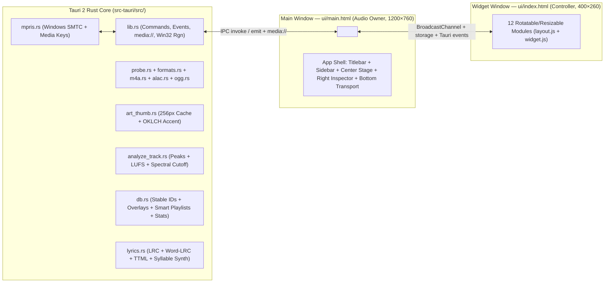

# Halftone v1.1 — Information Architecture (`spec-rebuild`)

## 1. Dual-Window Surface Topology

## 2. Main Window (`ui/main.html`) Spatial Regions
1. **Top Custom Titlebar (`38px`)**:
   - Drag region (`data-tauri-drag-region`), Brand mark + active Signal Badge (`FLAC 24/96`), Global Command Search (`Ctrl+K`), Layout Edit toggle (`Ctrl+L`), Theme/Mode/Palette quick switcher, Pop-out Widget toggle (`Ctrl+M`), Minimize/Maximize/Close window controls.
2. **Left Navigation Rail (`220px`, collapsible to `64px`)**:
   - **Library**: `All Tracks`, `Albums`, `Artists`, `Genres`, `Folders`, `Cover Flow`, `Recently Added`, `Most Played`, `Liked Songs`.
   - **Experience & Tools**: `Now Playing Stage`, `Visualizer & EQ`, `Smart Playlists`, `Library Health`, `Listening Stats`, `Theme Gallery`, `Settings`.
   - **Playlists**: User playlists (`+ New Playlist`, `+ Smart Playlist`, `Import/Export M3U8`).
3. **Center Stage (Fluid `1fr`)**:
   - Switches cleanly via `opacity` + `translateY(6px)` transitions (`180ms`) with virtualized rendering for 50,000+ tracks:
     - **Tracks Table**: Sticky headers, sortable columns (`#`, `Title`, `Artist`, `Album`, `Format/Bitrate`, `Duration`, `Plays`, `Liked`), inline heart/queue actions, multi-select, right-click context menu.
     - **Albums / Artists / Genres / Folders**: Responsive `160px–200px` card grids with lazy 256px thumbnails (`art_thumb`), hover play overlay, and expandable inline view.
     - **Cover Flow**: Digital 3D hardware-accelerated perspective carousel (`perspective: 1100px`, `rotateY(±52deg)`, floor reflection, flip-to-tracklist) and Analogue 9-cover pre-dithered horizontal canvas strip.
     - **Now Playing Stage (`F` / `F11`)**: 4 sub-arrangements (`Split View`, `Hero Art`, `Lyrics Stage`, `Minimal`) over 6 WebGL2 shaders (Digital) or 4 Canvas 2D dither/matrix modes (Analogue) with Apple Music–style word-lit spring lyrics and tap-to-sync `.lrc` editor.
     - **Visualizer & 10-Band EQ**: Interactive SVG frequency response curve (`31Hz–16kHz`) + preamp + 11 presets + Crossfeed/Balance/Mono/Loudness controls + live 60fps Spectrum/Waveform/Spectrogram.
     - **Smart Playlists / Library Health / Listening Statistics / Theme Gallery / Settings**: Dedicated full-featured panels.
4. **Right Inspector Drawer (`300px`, toggleable)**:
   - Tabs: **Up Next Queue** (FLIP drag-and-drop reorder, clear, save as playlist), **Synced Lyrics** (auto-scroll, click-to-seek, offset `±100ms`, word-lit highlights), **Track Details & Tag Overlay Editor** (codec, sample rate, bit depth, channels, LUFS, ReplayGain, spectral cutoff badge, non-destructive metadata overlay editor).
5. **Bottom Persistent Transport Bar (`84px`)**:
   - Left: Mini cover art (shared-element transition trigger), scrolling title/artist, Like button, Signal Path badge popover trigger.
   - Center: Shuffle, Prev, Play/Pause (morphing SVG), Next, Repeat (`off`/`all`/`one`), interactive waveform/bar seek scrubber with hover timestamp & waveform preview tooltip.
   - Right: Lyrics drawer toggle, Queue drawer toggle, EQ popover toggle, A–B Loop indicator, Sleep Timer badge, Volume slider + mute, Mini Widget switch.

## 3. Widget Window (`ui/index.html`) Modular Canvas
12 canonical modules managed by [`ui/layout.js`](file:///c:/Users/traps/Documents/antigravity/hopeful-meitner/ui/layout.js):
`cover-art`, `track-marquee`, `transport-cluster`, `seek-bar`, `volume-control`, `visualizer`, `lyrics-ticker`, `like-button`, `mode-toggles`, `signal-badge`, `window-controls`, `mini-queue-drawer`.
- Supports 7 instant presets (`Classic`, `Compact Strip`, `Square Art`, `Vertical Rack`, `Lyrics Focus`, `Meter Bar`, `Tilted Desk`) plus free drag, 8-handle resize, and arbitrary-angle rotation (`rotate(deg)`).
